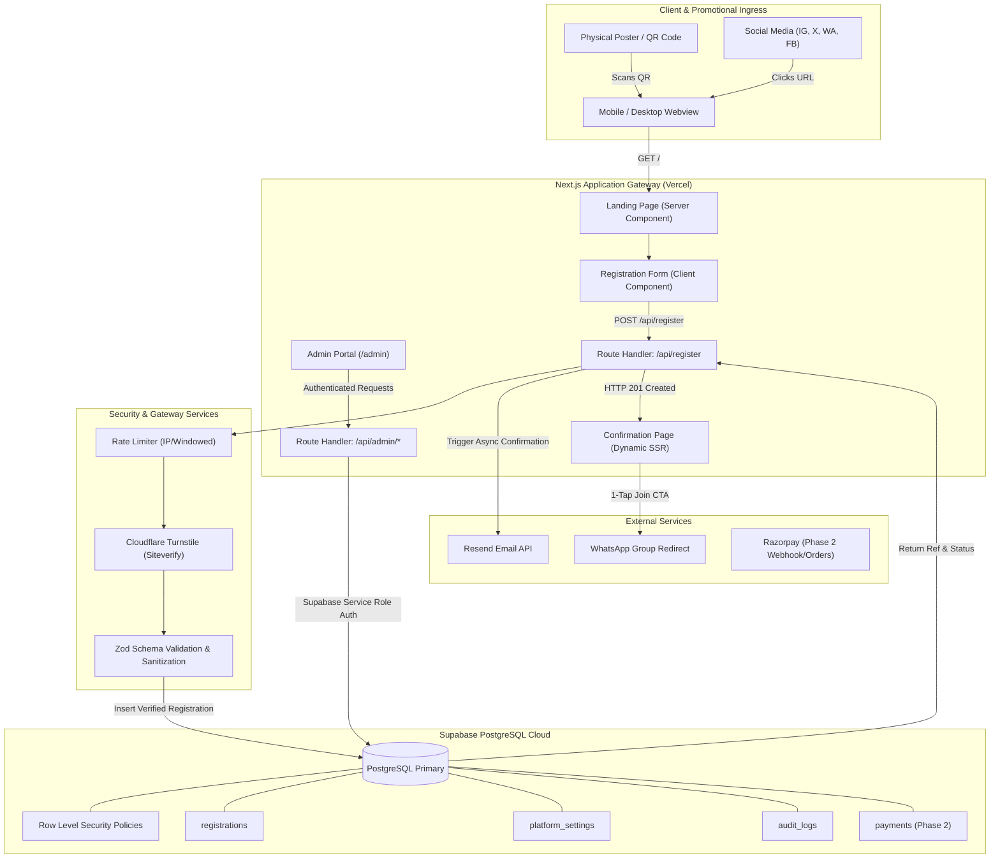

# System Architecture: High-Conversion Registration & Onboarding Platform

---

## 1. Architectural Philosophy & Overview

The platform is designed around five core principles:
1. **Edge-Ready & Zero-Cold-Start UX:** Sub-second time-to-interactive for users arriving from physical posters and QR codes via in-app mobile browsers.
2. **Layered Defense & Bot Protection:** Proactive bot detection at the gateway (Cloudflare Turnstile) coupled with rate limiting and strict server-side Zod validation.
3. **Resilient Data Persistence:** Single source of truth in Supabase PostgreSQL with strict Row Level Security (RLS) policies, atomic transactions, and duplicate prevention.
4. **Decoupled Asynchronous Integrations:** High-priority submission workflows never block on third-party services (Resend, WhatsApp webhooks). Registration succeeds even if external email delivery encounters intermittent network issues.
5. **Phase 2 Payment Extensibility:** Clean decoupling of registration records from payment states, enabling frictionless activation of Razorpay order creation and signature verification.

---

## 2. Architecture Diagram



---

## 3. Layer Breakdown

### 3.1 Ingress & Routing (Next.js App Router)
* **`app/page.tsx`**: High-performance landing page combining cached server components for static sections (Hero, Benefits, Event Info, FAQ) with dynamic interactive components for the registration form.
* **`app/register/page.tsx`**: Direct deep link to the registration flow (useful for direct QR codes pointing specifically to the form view).
* **`app/confirmation/[reference]/page.tsx`**: Dynamic success screen showing the registration reference, QR ticket badge, calendar invitation, and primary WhatsApp onboarding CTA.
* **`app/admin/...`**: Protected administration dashboard for searching, filtering, and exporting attendee records.
* **`app/qr/...`**: Vector and raster QR-code generator utility for marketing and poster design.

### 3.2 API Route Handlers
* **`POST /api/register`**:
  * Receives payload: `{ fullName, email, phone, customFields, turnstileToken }`.
  * Verifies Cloudflare Turnstile token via Cloudflare `siteverify` endpoint.
  * Validates structure and sanitizes inputs with Zod.
  * Checks for duplicate active registrations (by email or phone).
  * Generates cryptographically collision-resistant reference ID (e.g. `REG-2026-XXXX`).
  * Inserts record into Supabase PostgreSQL `registrations` table.
  * Fires asynchronous email dispatch via Resend.
  * Returns `{ success: true, reference, whatsappUrl }`.
* **`GET /api/admin/registrations`**:
  * Authenticated route with session / bearer token check.
  * Supports pagination, full-text search, status filter (`confirmed`, `pending`, `cancelled`), and sorting.
* **`GET /api/admin/export`**:
  * Streams RFC-4180 compliant CSV export with proper header quoting and formula-injection guards.
* **`PATCH /api/admin/settings`**:
  * Updates dynamic platform settings (WhatsApp group URL, registration status, announcements).

### 3.3 Database & Row Level Security (Supabase PostgreSQL)
* All database interactions from public users are mediated strictly via Next.js Route Handlers using parameterized queries.
* Row Level Security (RLS) is enabled on all tables:
  * Public anonymous access is denied read access across the table to prevent harvesting personal data.
  * Server-side route handlers use the secure `SUPABASE_SERVICE_ROLE_KEY` (never exposed to client-side bundles) to perform authorized operations.

### 3.4 Community Onboarding & Deep Linking
* Modern mobile operating systems (iOS and Android) support protocol-based deep links (`whatsapp://chat?code=...`) as well as standard HTTPS universal links (`https://chat.whatsapp.com/...`).
* The platform implements an intelligent redirect component:
  1. Primary CTA: Direct universal WhatsApp group link configured in platform settings.
  2. Backup Fallback: In-app browser detection advice (prompts user to "Open in external browser" if the in-app webview suppresses WhatsApp intent links).
  3. Persistent Reference: The user receives the exact group link and pass code via confirmation email.

---

## 4. Phase 2 Payment Extensibility

```
[Registration Form Submission]
              │
              ▼
    [Create Pending Registration]
              │
              ▼
    [POST /api/payments/razorpay/order]
    - Generates Razorpay Order via Razorpay SDK
    - Associates order_id with registration_id
              │
              ▼
    [Razorpay Checkout Modal / SDK]
    - Attendee completes UPI / Card / NetBanking
              │
              ▼
    [POST /api/payments/razorpay/verify] OR [Webhook: payment.captured]
    - Verifies HMAC SHA256 signature using RAZORPAY_KEY_SECRET / WEBHOOK_SECRET
    - Idempotently updates registration_status = 'confirmed'
    - Updates payment_status = 'completed'
              │
              ▼
    [Unlock WhatsApp Group CTA & Send Ticket Email]
```

This decoupled architecture ensures that in Phase 1, registrations transition directly to `confirmed` without payment friction, while in Phase 2, the exact same state machine unlocks the confirmation and WhatsApp link only upon verified payment confirmation.
