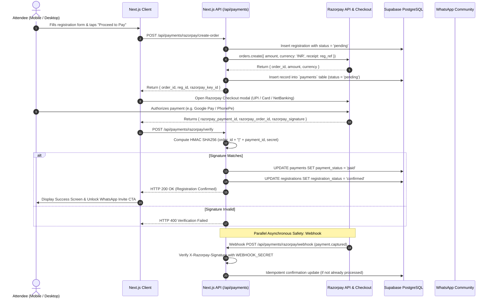

# Phase 2: Razorpay Payment Integration Architecture

---

## 1. Overview & Business Model

In Phase 1, the platform operates as a 100% free registration platform.
In Phase 2, the platform can be configured to collect registration, ticketing, or membership fees via **Razorpay** prior to confirming attendance and unlocking the WhatsApp group invite.

---

## 2. End-to-End Payment Sequence

---

## 3. Webhook Idempotency & Edge Cases

1. **Network Disconnection After Payment:**
   * If a user completes payment on UPI, but their mobile browser crashes or loses cellular connection before the client POST verification completes:
   * Razorpay fires the server-to-server webhook `payment.captured`.
   * The webhook handler validates the signature and atomically sets `registration_status = 'confirmed'` and `payment_status = 'paid'`.
   * When the user re-opens their confirmation link or searches their email, their ticket and WhatsApp access are already active.
2. **Replay & Double Charge Prevention:**
   * Each registration is locked to a single active Razorpay `order_id`.
   * Webhook processing checks if `payments.payment_status == 'paid'`. If already processed, it responds with `200 OK` without duplicate side effects.
3. **Card/UPI Details Compliance:**
   * The application **never** receives, handles, or stores raw credit card numbers, CVVs, or UPI PINs. All payment processing is strictly handled by Razorpay's PCI-DSS Level 1 compliant infrastructure.

---

## 4. Activation Checklist for Platform Owner

To transition from Phase 1 (Free) to Phase 2 (Paid):
1. Sign up for a [Razorpay Merchant Account](https://razorpay.com).
2. Generate API Keys (Key ID and Key Secret) in Razorpay Dashboard > Settings > API Keys.
3. Configure Webhook URL: `https://your-domain.com/api/payments/razorpay/webhook` with event `payment.captured`.
4. Add the following to your Vercel Environment Variables:
   * `NEXT_PUBLIC_RAZORPAY_KEY_ID=rzp_live_...`
   * `RAZORPAY_KEY_SECRET=...`
   * `RAZORPAY_WEBHOOK_SECRET=...`
5. In `platform_config.json` or database `platform_settings`:
   * Set `"enablePayments": true`
   * Set `"registrationFeeInINR": 499` (or appropriate amount)
