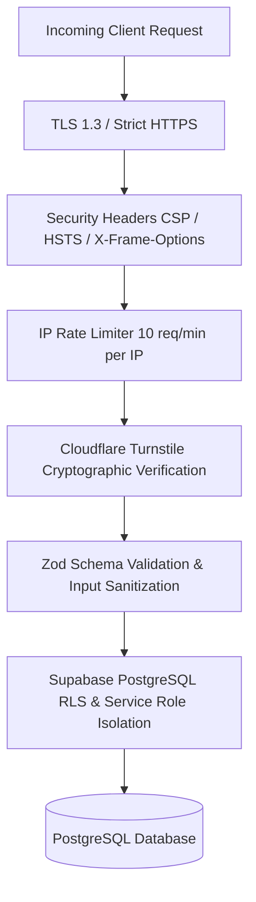

# Security Architecture & OWASP Top 10 Hardening Guide

---

## 1. Threat Model & Ingress Points

The platform is designed to be publicized on physical posters, QR codes, and high-traffic social media campaigns. Consequently, it faces threats from:
1. Automated spam bots submitting arbitrary form entries.
2. Distributed Denial of Service (DDoS) / rate exhaustion attacks.
3. SQL Injection, XSS, and Cross-Site Request Forgery (CSRF).
4. Data harvesting of attendee personal identifiable information (PII).
5. Unauthorized administrative tampering or unauthorized CSV data dumps.
6. WhatsApp invite link scraping and malicious distribution.

---

## 2. Layered Defense Strategy

### 2.1 Bot Protection: Cloudflare Turnstile
* **Client-side Widget:** Rendered without invasive captchas. On submit, collects a single-use cryptographically signed token.
* **Server-side Validation:** The Next.js API route handler executes a POST request directly to `https://challenges.cloudflare.com/turnstile/v0/siteverify` passing `secret` and `response`.
* **Zero Trust:** If the verification returns `success: false`, the request is immediately rejected with HTTP 403 Forbidden.
* **Single-Use Guard:** Cloudflare tokens expire within 300 seconds and cannot be replayed.

### 2.2 Input Sanitization & Anti-Injection
* **Zod Schemas:** All incoming JSON payloads are parsed and validated strictly against strongly typed schemas:
  * `fullName`: string length 2–100, trimmed, stripped of HTML tags.
  * `email`: strict email regex validation, converted to lowercase.
  * `phone`: sanitized to allowed phone characters (`+`, numbers, spaces, hyphens).
  * `customFields`: validated against the declared JSON schema.
* **SQL Injection Immunity:** All database queries are executed via parameterized queries using the Supabase PostgREST client. No raw string interpolation into SQL queries is ever performed.

### 2.3 Row Level Security (RLS) & PII Protection
* **Complete Public Read Denial:** The `registrations` table has RLS enabled with a default deny policy for `SELECT` operations. No unauthenticated user can query `/rest/v1/registrations` to harvest attendee names, emails, or phone numbers.
* **Service Role Confinement:** The `SUPABASE_SERVICE_ROLE_KEY` is strictly confined to server-side Node.js runtime environments (`process.env.SUPABASE_SERVICE_ROLE_KEY`). It is never prefixed with `NEXT_PUBLIC_` and never included in browser client bundles.

### 2.4 Administrative Access Control
* **Admin Route Protection:** All `/admin/*` pages and `/api/admin/*` endpoints require validated authentication.
* **Session Verification:** Administrative operations verify JWT or secure session cookies before granting read or write permissions.
* **CSV Formula Injection Prevention:** When generating CSV exports, all cells starting with `=, +, -, @` are prepended with a single quote (`'`) to neutralize malicious formula execution in Microsoft Excel or Google Sheets.

### 2.5 Security Headers (HTTP)
The Next.js configuration enforces modern security headers on all responses:
* `Content-Security-Policy`: Restricts script, style, frame, and connect origins to verified domains (Cloudflare, Supabase, Google Analytics, Vercel).
* `Strict-Transport-Security`: `max-age=63072000; includeSubDomains; preload`
* `X-Content-Type-Options`: `nosniff`
* `X-Frame-Options`: `DENY` (prevents clickjacking)
* `Referrer-Policy`: `strict-origin-when-cross-origin`
* `Permissions-Policy`: `camera=(), microphone=(), geolocation=()`

---

## 3. WhatsApp Group Invitation Security

### Important Real-World Security Clarification:
A standard WhatsApp group invite link (`chat.whatsapp.com/xxx`) is a public invite URL. Anyone who obtains the link can join the group or forward it. 

### Mitigations Implemented:
1. **Gate Delivery Behind Valid Registration:** The WhatsApp link is only revealed upon successful validation and database insertion.
2. **Dynamic Admin Revocation:** The administrator can change or reset the WhatsApp invite link in the admin portal at any time if link abuse or unauthorized entry is detected.
3. **Phase 2 Recommendations:** 
   * WhatsApp Community with announcement-only channel: Group settings set to "Only admins can send messages" to prevent spam.
   * WhatsApp Group Admin Approval: In WhatsApp group settings, enable "Approve new participants". When users click the link, their join request must be matched with the attendee list by the community admin before approval.
